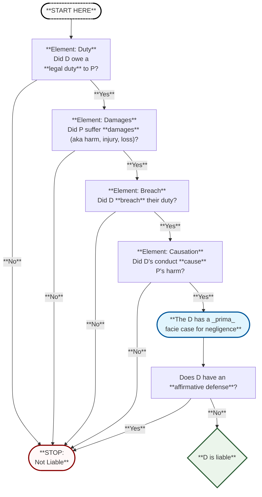

### When is there a duty?

1. **Foreseeability**  
 
 - Common law duty to avoid causing foreseeable harm to others

2. **On the Premises**
   - Owners/Possessors of a premises owe special duty to warn

3. **Special Relationships**
   - Special duties owed to certain relationship counterparts

4. **Creation of Risk**
   - Duty created when person creates a risk to others

5. **Assumption of Duty**
   - Duty exists when person assumes a duty that didn't previously exist

6. **Contract**
   - Contracts create duties between the contracting parties

---

Overview Flowchart
 

