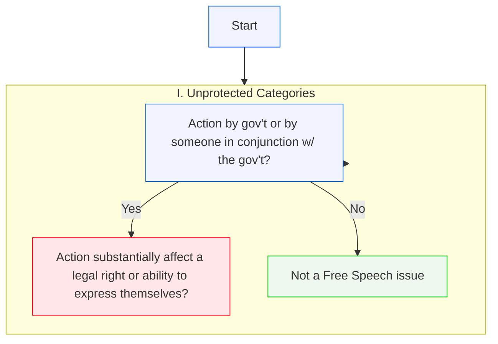

## Agenda

!toc

---

# Introduction to Business & The Constitution
## A Few Selections

---

!poll[What is your biggest challenge?](https://openpoll.pages.dev/poll/-TNTVZZZsA)

---

## Introduction to Federalism

---

!poll[What is your biggest challenge?](https://openpoll.pages.dev/poll/-TNTVZZZsA/vote)

---

##### Once a Upon a Time...

- A federal law prohibits the possession, sale, and distribution of cannabis, products containing cannabis, and products containing any chemical derivatives of cannabis.

- Later, Wisconsin enacts a law permitting businesses to operate retail establishments selling cannabis, products containing any chemical derivatives of cannabis.<!-- step -->

---

##### Once a Upon a Time...

- The Federal Aviation Administration (FAA) passes a "Commercial Drone Safety Act," stating that:
> Drones used to transport goods from retailers to purchasers weighing less than 50 pounds may operate between 7:00 am and 10:00 pm, subject to other federal licensing and safety requirements. 

- Later, Mequon adopts an ordinance, stating that:
> For the purposes of decreasing noise pollution, privacy interests of residents, and safety of the public, all use of drones used to transport goods from retailers to purchases within the city limits is prohibited.

---

##### Once a Upon a Time...

- Wisconsin law states that establishments selling foodstuffs what place both butter and margarine on a table or counter for customers, all margarine products must have been manufactured to include pink dyes.
- Congress passes a law prohibiting manufacturers of butter and butter substitutes from adding dyes or other coloring agents to their products. <!-- step -->

---

##### Once a Upon a Time...

- Wisconsin passes a new sales tax law that says:
> - Wisconsin residents who purchase a product within the State of Wisconsin manufactured in Wisconsin must pay a sales tax of 6.0%.
> - Wisconsin residents who purchase a product within the State of Wisconsin that was manufactured outside of Wisconsin must pay a sales tax of 8.25%

---
###### Federalism diagram

---

##### Free Speech
- If Yes, !ref[#### ]

